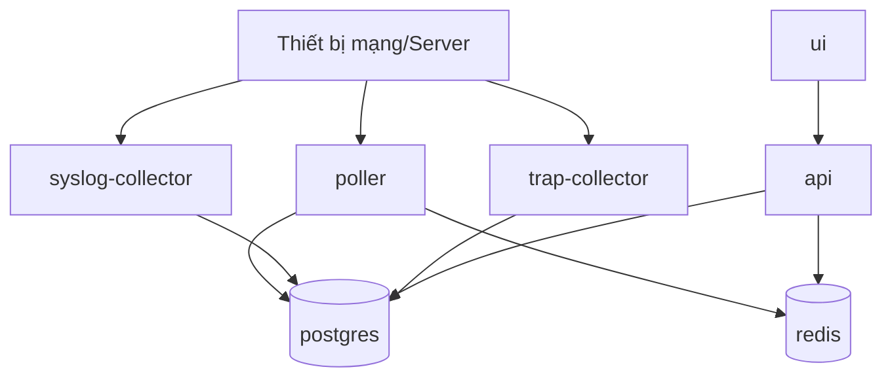
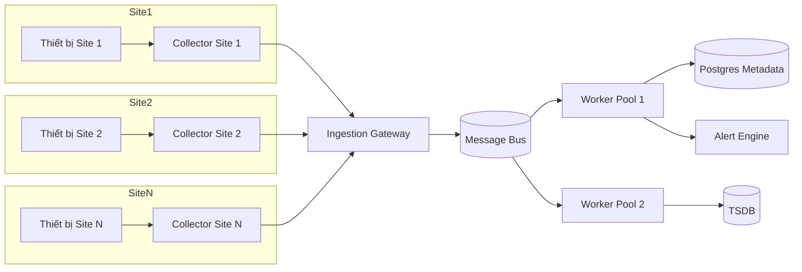

# Thiết kế chi tiết mở rộng giám sát đa site (Docker)

Tài liệu này mô tả kiến trúc và cách triển khai để hệ thống có thể chạy tốt ở 2 chế độ:

1. Chỉ giám sát 1 site (đơn giản, chi phí thấp).
2. Mở rộng đa site linh hoạt khi có nhu cầu (không phải thay lại toàn bộ nền tảng).

---

## 1) Mục tiêu thiết kế

1. Bắt đầu nhanh với 1 site bằng Docker Compose.
2. Khi tăng quy mô, chuyển dần sang mô hình multi-site bằng cách thêm các service mà không phá vỡ luồng cũ.
3. Tách rõ Control Plane (quản trị) và Data Plane (thu thập dữ liệu).
4. Hỗ trợ phân quyền theo site, cảnh báo theo site, dashboard global.
5. Có khả năng chịu lỗi WAN liên site (store-and-forward tại site).

---

## 2) Kiến trúc tổng quan

```mermaid
flowchart LR
  subgraph CP[Control Plane (Trung tâm)]
    UI[UI]
    API[API]
    PG[(PostgreSQL)]
    REDIS[(Redis)]
    UI --> API
    API --> PG
    API --> REDIS
  end

  subgraph DP1[Site Collector A]
    E1[Edge Collector A]
    D1[Thiết bị Site A]
    D1 -->|SNMP, ICMP, Syslog, Trap| E1
  end

  subgraph DP2[Site Collector B]
    E2[Edge Collector B]
    D2[Thiết bị Site B]
    D2 -->|SNMP, ICMP, Syslog, Trap| E2
  end

  E1 -->|mTLS, batch| ING[Ingestion Gateway]
  E2 -->|mTLS, batch| ING
  ING --> BUS[(Kafka/NATS/Redis Streams)]
  BUS --> PROC[Processors and Alert Workers]
  PROC --> PG
  PROC --> TS[(TSDB: ClickHouse/VictoriaMetrics)]
  PROC --> OBJ[(Object Storage)]
  API --> TS
```

Ghi chú:

1. Ở mode 1 site, có thể chưa cần Ingestion Gateway và BUS, poller ghi trực tiếp DB như hiện tại.
2. Ở mode multi-site, collector tại mỗi site đẩy dữ liệu về trung tâm qua Ingestion Gateway để scale ngang.

---

## 3) Thiết kế cho 2 trường hợp triển khai

### 3.1) Trường hợp A: Giám sát 1 site

Mục tiêu: đơn giản, dễ vận hành.

Thành phần:

1. `ui`
2. `api`
3. `poller`
4. `syslog-collector`
5. `trap-collector`
6. `postgres`
7. `redis`

Sơ đồ:



Đặc điểm:

1. Dễ triển khai, ít thành phần.
2. Phù hợp từ vài chục đến vài nghìn thiết bị (tùy profile polling).
3. Tăng tải bằng cách tăng worker poller và tối ưu chu kỳ poll.

### 3.2) Trường hợp B: Mở rộng đa site linh hoạt

Mục tiêu: tách thu thập dữ liệu khỏi trung tâm quản trị để scale tốt và chịu lỗi WAN.

Thành phần bổ sung:

1. Edge Collector tại từng site.
2. Ingestion Gateway ở trung tâm.
3. Message Bus để tách ingest và processing.
4. Processor workers scale ngang.
5. TSDB riêng cho dữ liệu time-series lớn.

Sơ đồ:



Đặc điểm:

1. Site vẫn thu thập được dữ liệu khi WAN mất.
2. Scale bằng cách thêm collector site và thêm processor worker.
3. Phân quyền và báo cáo theo site rõ ràng.

---

## 4) Luồng dữ liệu chuẩn cho multi-site

1. API trung tâm quản lý cấu hình thiết bị/rule theo `siteId`.
2. Collector site lấy cấu hình (pull định kỳ hoặc push event từ API).
3. Collector poll SNMP/ICMP cục bộ, nhận syslog/trap cục bộ.
4. Collector chuẩn hóa payload, gắn `siteId`, nén và gửi về Gateway.
5. Gateway xác thực mTLS, ghi vào BUS theo partition key `siteId:deviceId`.
6. Worker đọc BUS, cập nhật status/metric/alert.
7. API/UI truy vấn dữ liệu theo quyền site của người dùng.

---

## 5) Thiết kế triển khai Docker

### 5.1) Cấu trúc stack khuyến nghị

1. `stack-core`: UI, API, Postgres, Redis (và TSDB khi cần).
2. `stack-site-collector`: poller, syslog/trap collector tại site.
3. `stack-ingestion`: ingestion gateway + message bus + workers (cho multi-site).

### 5.2) Mô hình network

1. Mỗi site chạy collector trong LAN local.
2. Collector outbound TLS về trung tâm (không cần mở inbound vào site).
3. Trung tâm mở endpoint ingest cố định (443).

### 5.3) Cấu hình bằng profile

Dùng Docker Compose profile để bật/tắt mode:

1. `single-site`: chạy `ui api poller syslog-collector trap-collector postgres redis`.
2. `multi-site-core`: chạy `ui api postgres redis gateway bus workers`.
3. `site-collector`: chạy collector cục bộ tại từng site.

Ví dụ logic profile:

```yaml
services:
  poller:
    profiles: ["single-site", "site-collector"]
  ingestion-gateway:
    profiles: ["multi-site-core"]
  worker:
    profiles: ["multi-site-core"]
```

---

## 6) Lộ trình nâng cấp linh hoạt từ 1 site lên multi-site

### Giai đoạn 1: Chuẩn hóa 1 site (không đổi trải nghiệm)

1. Chuẩn hóa dữ liệu theo `siteId` cho mọi bản ghi metric/event/alert.
2. Chuẩn hóa cấu hình poll profile theo site.
3. Đo baseline tải hiện tại: số thiết bị, số interface, queue lag, DB IOPS.

### Giai đoạn 2: Tách collector cho site lớn đầu tiên

1. Đặt collector tại site lớn.
2. Tắt poll trực tiếp thiết bị của site này từ core.
3. Chuyển dữ liệu site này về trung tâm qua ingest channel.

### Giai đoạn 3: Bật ingestion + worker pool

1. Thêm gateway + bus + worker ở trung tâm.
2. Chuyển dần các site còn lại sang collector local.
3. Scale worker theo lag và throughput.

### Giai đoạn 4: Tối ưu quy mô lớn

1. Tách time-series sang TSDB chuyên dụng.
2. Bật retention nhiều tầng (hot, warm, cold).
3. Correlation alert liên site và chống trùng lặp cảnh báo.

---

## 7) HA, DR và SLO

### 7.1) HA tối thiểu

1. Postgres primary + replica.
2. Redis có persistence và backup định kỳ.
3. API chạy >= 2 replicas sau reverse proxy.

### 7.2) DR

1. Backup metadata bằng PITR.
2. Snapshot object storage theo lịch.
3. DR drill mỗi quý với kịch bản mất 1 DC.

### 7.3) SLO vận hành

1. Poll success rate >= 99% theo site.
2. Alert delivery p95 < 15 giây.
3. Ingestion lag p95 < 30 giây.

---

## 8) Bảo mật và phân quyền đa site

1. Mỗi collector có certificate riêng, rotate định kỳ.
2. Toàn bộ payload collector -> core dùng mTLS.
3. RBAC theo site: chỉ xem/điều khiển site được cấp quyền.
4. Secret SNMP mã hóa at-rest, không ghi plaintext ra log.

---

## 9) Sizing tham chiếu

### 9.1) Khoảng 1.000 thiết bị

1. Core: 4 vCPU, 16 GB RAM.
2. Postgres: 8 vCPU, 32 GB RAM, NVMe.
3. Redis: 2 vCPU, 8 GB RAM.

### 9.2) Khoảng 5.000 thiết bị

1. Thêm worker pool riêng và bus riêng.
2. Tách TSDB ra node riêng.
3. Tối thiểu 1 collector/site lớn hoặc 1 collector/1.500 thiết bị.

### 9.3) Khoảng 20.000 thiết bị

1. Bắt buộc multi-site collector.
2. Bắt buộc bus partition theo site/device.
3. Bắt buộc TSDB cluster và retention nhiều tầng.

---

## 10) Checklist triển khai thực tế

### Single-site

1. Chuẩn bị host Docker và volume dữ liệu.
2. Khởi chạy `single-site` profile.
3. Import thiết bị và chạy discovery.
4. Kiểm tra queue lag, DB write latency, alert latency.

### Multi-site

1. Triển khai core profile ở trung tâm.
2. Triển khai collector profile tại từng site.
3. Cấp cert mTLS cho collector.
4. Mapping collector <-> siteId.
5. Chuyển dần site từ poll trực tiếp sang poll qua collector.
6. Theo dõi lag và scale worker.

---

## 11) Rủi ro và biện pháp giảm thiểu

1. WAN không ổn định giữa site và core:
Biện pháp: collector buffer local + retry backoff + nén batch.

2. Bùng nổ alert khi sự cố diện rộng:
Biện pháp: dedupe theo fingerprint, suppression theo maintenance window.

3. DB nóng khi số thiết bị tăng nhanh:
Biện pháp: tách TSDB, pre-aggregate, giảm tần suất poll non-critical.

---

## 12) Kết luận

Thiết kế này cho phép bắt đầu nhanh với 1 site theo đúng stack Docker hiện tại, sau đó nâng cấp dần lên multi-site linh hoạt bằng cách thêm lớp collector + ingestion + worker mà không cần phá vỡ Control Plane hiện có.
